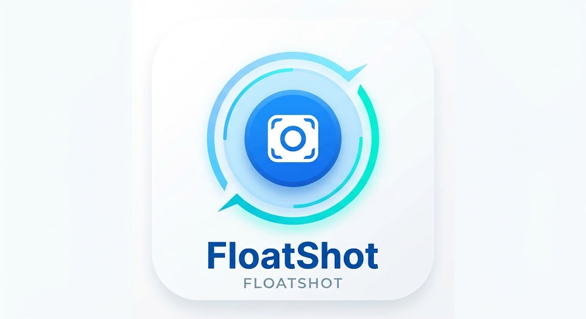

# FloatShot

## FloatShot

A small Android app that puts a floating camera button on top of every app. Tap the button to take a screenshot. 

## Features

- **Floating button** that stays on top of all apps
- **Clean screenshots**: the button is hidden before the screenshot is taken
- **Draggable**: move the button anywhere. It snaps to the nearest edge and remembers its position
- **Quick close**: long-press the button for about a second, or tap *Stop* in the notification
- **Rotation support**: screenshots keep the right shape when you rotate the phone
- **Dark mode** on the start screen
- **No third-party libraries**

Screenshots are saved as PNG files in `Pictures/FloatShot` and show up in your Gallery.

## Requirements

- Android 10 (API 29) or newer on the phone
- Android Studio with JDK 17 or newer to build

## Getting started

1. Clone the repository:
   ```bash
   git clone https://github.com/<your-username>/FloatShot.git
   ```
2. Open the folder in Android Studio (**File → Open**) and let Gradle sync.
3. Press **Run** to install on a connected phone, or use **Build → Generate APKs**.

## Building an APK

Every build creates two APK files in `app/build/outputs/apk/debug/` (or `release/`):

| File | Purpose |
|---|---|
| `app-debug.apk` | Used by Android Studio's **Run** to install on your phone |
| `FloatShot YYYYMMDD HHMM.apk` | A timestamped copy you can share or keep, e.g. `FloatShot 20261024 1505.apk` |

Release builds get `release` added to the name, e.g. `FloatShot 20261024 1505 release.apk`.

From the command line:

```bash
./gradlew assembleDebug        # macOS / Linux
gradlew.bat assembleDebug      # Windows
```

> **Note:** `Build → Clean Project` empties the `build` folder. Copy APKs you want to keep somewhere else.

## First run

1. Open FloatShot and tap **Allow display over other apps**. Turn FloatShot on in the settings page.
2. Go back and tap **Show the button**.
3. Android asks for screen capture permission. Choose **Entire screen**. If you pick a single app, only that app will appear in the screenshots.
4. The button appears. Open any app and tap the button.

> **Note:** Android asks for screen capture permission every time the button is started. This is a system rule and cannot be turned off.

## How it works

- `BubbleService` is a foreground service of type `mediaProjection`. It mirrors the screen into an `ImageReader` and keeps only the newest frame.
- On tap, the button is hidden and the service waits for a frame drawn at least 60 ms later. If no new frame arrives within 700 ms, it uses the newest frame captured after the button was hidden.
- The image is saved through MediaStore to `Pictures/FloatShot`.
- When the screen rotates, the virtual display is resized to match.

## Permissions

| Permission | Why |
|---|---|
| `SYSTEM_ALERT_WINDOW` | Show the button on top of other apps |
| `FOREGROUND_SERVICE` + `FOREGROUND_SERVICE_MEDIA_PROJECTION` | Keep screen capture running |
| `POST_NOTIFICATIONS` | Show the notification while the button is active |

## Limitations

- Apps that protect their content (`FLAG_SECURE`), such as banking apps and some streaming services, appear black in screenshots. Android itself blocks this.
- On Android 15 and newer, apps can detect that the screen is being recorded while the button is active.
- Android shows a screen-sharing indicator in the status bar while the button is running.

## Project structure

```
FloatShot/
├── app/
│   ├── build.gradle.kts         # App config + timestamped APK naming
│   └── src/main/
│       ├── java/com/fardin/floatshot/
│       │   ├── MainActivity.kt  # Start screen, permissions, start/stop
│       │   └── BubbleService.kt # Floating button + screenshot capture
│       ├── res/                 # Layouts, strings, colors, icons
│       └── AndroidManifest.xml
├── build.gradle.kts
├── settings.gradle.kts
└── gradle.properties
```

## Tech stack

- Kotlin (built into AGP 9)
- Android Gradle Plugin 9.4.1
- Gradle 9.8.0
- compileSdk / targetSdk 35, minSdk 29
- Java 17
